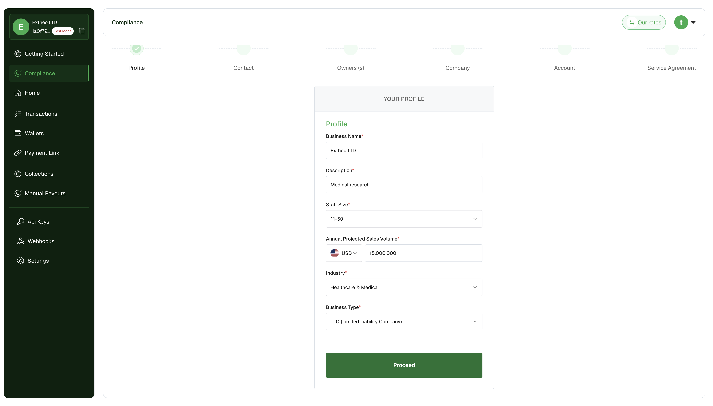
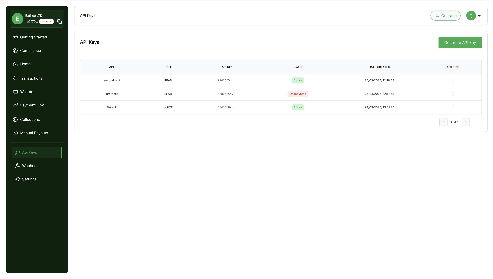
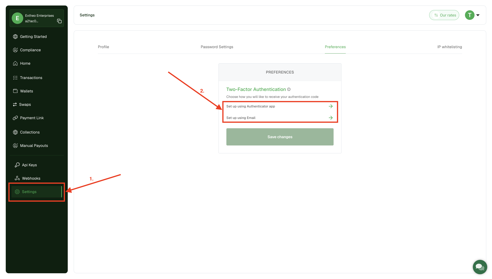
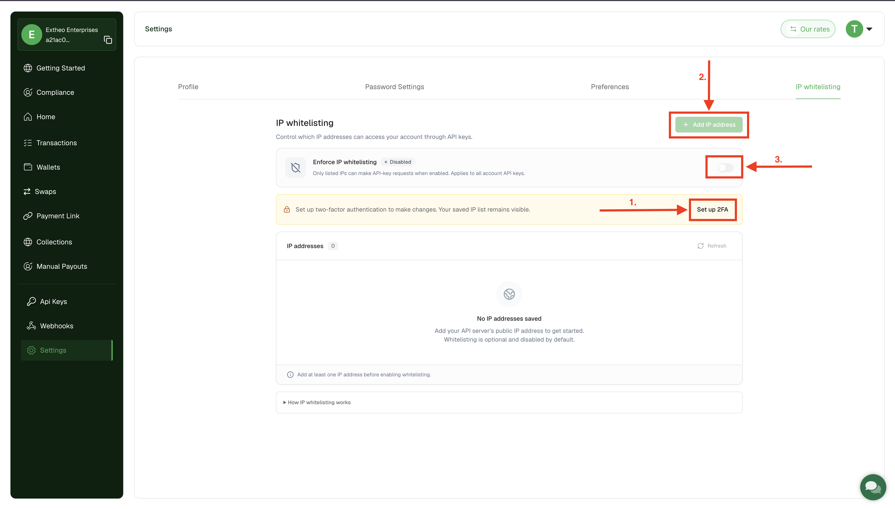

### Step 1: Create an account

Create a [free Mavapay account](https://mavapay.co). By default, you should use the [test environment](https://staging.mavapay.co) until you are done with the integration and are ready to go live.

### Step 2: Complete compliance (Production)
After creating your account on `https://mavapay.co`, complete the compliance section before API key generation is enabled.



### Step 3: Generate your API key
Once your compliance submission is approved, go to the API Keys section and generate your API key.



These keys are a 32 character string. You will need them to authenticate your requests to the Mavapay API.
Here's a sample of what your API keys will look like:

```json
{
  "apiKey": "e2a81dcbcc459e3c96c15fe88db653051949058d908"
}
```

### Step 4: Start building
You can now start building with the Mavapay API.
In the staging environment, you would be able to:

1. Collect payments using mocked card data
2. Make transfers to dummy accounts (bank accounts and mobile money wallets).
3. Build with our wallets (using mock data), including the USDT wallet for deposits and withdrawals.
4. Configure your integration to handle different scenarios like failed payments, successful payments, etc.
5. Complete KYC verification and go live with your integration.

<Note>
  On sandbox (`https://staging.mavapay.co`), compliance approval is instant for testing, so you do not need to fill the compliance form before generating test API keys.
</Note>

### IP whitelisting

IP whitelisting limits which networks can call the API with your keys. When it is turned on, Mavapay accepts requests only from the IP addresses you save. Requests from any other address are rejected. The list applies to every API key on the account.

Whitelisting is optional and off by default. You can turn it off again at any time. We recommend leaving it on in production so a leaked API key cannot be used from an unknown network.

You manage it from the [dashboard](https://mavapay.co). The same steps apply on [sandbox](https://staging.mavapay.co). Two-factor authentication has to be set up before you can add addresses or change the setting.

#### Set up two-factor authentication

Open **Settings**, then **Preferences**. Under **Two-Factor Authentication**, choose how you want to receive codes:

- **Authenticator app** for a time-based one-time password (TOTP)
- **Email** for a code sent to your account email



Until this is done, your saved IP list stays visible, but you cannot add or remove addresses or change enforcement.

#### Add IP addresses

Open **Settings**, then **IP whitelisting**, and select **Add IP address**. Enter the public IP of each server that calls the API. You can save more than one address.

Both IPv4 and IPv6 are supported, for example `203.0.113.10` or `2001:db8::1`.

Use the public address your server uses for outbound traffic. A private address such as `10.0.0.1` or `192.168.1.1` will not match requests that reach the API.

#### Turn enforcement on or off

After you have added at least one address, turn on **Enforce IP whitelisting**. Only the addresses in your list can call the API while the toggle is on.

To stop restricting traffic, turn the toggle off. Your saved addresses stay in the list, so you can turn the feature back on later without entering them again.



<Note>
  Add the address you are connecting from before you enable enforcement. Otherwise calls from that server are rejected.
</Note>

{/* <Card
  title="Mavapay API Endpoints Schema"
  icon="leaf"
  href="https://github.com/stealthmoney/mavapay-docs/blob/main/api-reference/openapi.json"
>
  View our OpenAPI specification file
</Card> */}
